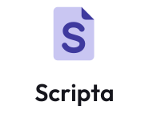

<p align="center">
  
</p>

<p align="center">
  <strong>Self-hosted PDF tools you own.</strong><br>
  Edit, sign, convert, number and organise PDFs on your own server.
</p>

<p align="center">
  <a href="https://github.com/stephenstirling/scripta/actions/workflows/ci.yml"></a>
  <a href="LICENSE"></a>
  <a href="https://buymeacoffee.com/stephenstirling"></a>
</p>

---

Scripta is a web-based PDF toolkit you run yourself. It has 50+ tools, including merging, splitting,
OCR, redaction, compression, conversion, certificate signing, form filling, comparison and a text
editor. Files are processed on your server and never sent to a third party.

## What Scripta adds

- **Bates numbering**: stamps a prefix, a zero-padded number and a suffix (e.g. `ACME000001`) on
  every page across a whole set of PDFs. Numbering continues from one file to the next in the
  order you list them. Optionally names each output file after its Bates range.
- **Header & Footer**: up to six text slots (left, centre and right in the header and footer) in
  one pass, with `{n}`, `{total}`, `{filename}` and `{date}` tokens and a page range.
- **Correct placement on rotated and cropped pages**: page numbers, headers, footers and Bates
  labels follow each page's rotation and visible area. On scanned or rotated pages they land in the
  corner you picked and read upright.
- **Non-Latin text**: Cyrillic, Greek, Chinese, Japanese, Korean, Arabic, Hebrew, Thai and more work
  in page numbers, headers and Bates labels. A Unicode font is embedded automatically.

## Run it

### Docker (recommended, including Synology)

```bash
docker run -d --name scripta -p 8080:8080 \
  -v ./scripta/config:/configs \
  -v ./scripta/data:/usr/share/tessdata \
  ghcr.io/stephenstirling/scripta:latest
```

Then open <http://localhost:8080>. A compose file is in [`docker/compose/docker-compose.yml`](docker/compose/docker-compose.yml).
Images are published by the **Docker image** workflow (run it manually or push a `v*` tag). It
builds everything from this repository: `scripta-base` (the PDF toolchain: LibreOffice, Calibre,
Ghostscript, QPDF, ImageMagick, OCRmyPDF), then `scripta` on top of it.

To build the images yourself:

```bash
docker build -t ghcr.io/stephenstirling/scripta-base:latest docker/base
docker build -t ghcr.io/stephenstirling/scripta:latest -f docker/embedded/Dockerfile .
```

### Build from source

Requires JDK 25 and Node 22.

```bash
# backend + bundled frontend on :8080
./gradlew bootRun -PbuildWithFrontend=true

# or run them separately while developing
./gradlew :stirling-pdf:bootRun          # backend on :8080
cd frontend && npm ci && npx vite editor --mode core   # frontend on :5173
```

## Tests

```bash
./gradlew build -PnoSpotless                                   # backend
cd frontend && npx vitest run --root editor --project core     # frontend
```

## Credits and license

Scripta is a fork of the MIT-licensed core of [Stirling-PDF](https://github.com/Stirling-Tools/stirling-pdf)
by Stirling PDF Inc. and its contributors. Thank you to everyone who built it. The original
copyright notice is kept in [LICENSE](LICENSE).

Upstream's proprietary and SaaS modules (`app/proprietary`, `app/saas`, `engine`, and the
`proprietary`, `desktop`, `saas`, `cloud`, `portal` and `portal-saas` frontend layers) are under a
separate license and are **not** included here. Scripta is built from the MIT-licensed code only,
plus its own additions, which are also MIT-licensed.

Scripta is an independent project and is not affiliated with or endorsed by Stirling PDF Inc.

## Support

If Scripta saves you an Acrobat subscription, you can [buy me a coffee](https://buymeacoffee.com/stephenstirling).
